  

# 🚀 Awesome-Website-Monitoring

## 🌐 Top Website Monitoring Tools Ecosystem
**Curated List of SaaS Products & Open-Source GitHub Projects**
*Focused on Uptime Checks, Synthetic Monitoring, Status Pages, Alerting & Performance Observability*
**Last updated: August 2026**

This repository tracks notable **SaaS platforms** and **open-source projects** for **Website Monitoring / Uptime Monitoring**. These tools continuously probe websites, APIs, ports, SSL certificates, and services from global locations, detect downtime or degradation, send multi-channel alerts, and often provide public status pages and historical reporting.

**Examples** include Pingdom, UptimeRobot, Better Stack, Uptime.com, StatusCake, Site24x7, Freshping, HetrixTools, Hyperping, Montastic (the category leaders and popular options).

**Open-source emphasis** 🛠️: This section is heavily expanded with every major active project for self-hosting, full data ownership, unlimited monitors, config-as-code, and integration with existing observability stacks — ideal for developers, SREs, homelabbers, and companies building transparent, cost-controlled monitoring solutions.

Contributions welcome! 🤝 Open a PR to add/update entries. Keep descriptions factual and link to official sites / GitHub repos.

## 📑 Table of Contents
- [☁️ SaaS/Hosted Platforms](#saas-hosted-platforms)
- [🐙 Open-Source GitHub Projects](#open-source-github-projects)
- [🙌 How to Contribute](#how-to-contribute)
- [⚠️ Disclaimer](#disclaimer)

## ☁️ SaaS/Hosted Platforms

| Product 🏢 | Starting Price 💰 | Free Tier 🆓 | Company Size (Revenue / Valuation) 📊 |
|:--|:--|:--|:--|
| [Site24x7](https://www.site24x7.com/) | $9/mo (billed annually) | 5 monitors free forever | ~$1.6–3.2B (Zoho Corp. revenue) |
| [Freshping](https://www.freshworks.com/) | Discontinued (March 2026) | N/A — service shut down | $838.8M (Freshworks revenue) |
| [Pingdom](https://www.pingdom.com/) | $16.50/mo (billed annually) | 14-day free trial only — no permanent free tier | $796.9M (SolarWinds revenue) |
| [Checkly](https://www.checklyhq.com/) | $24/mo (Starter, billed annually) | Hobby $0 — 10 uptime monitors, 1,000 browser checks, 10,000 API checks/mo | $32.25M total funding |
| [Better Stack](https://betterstack.com/) (formerly Better Uptime) | $29/mo (Responder, billed annually) | 10 monitors + 10 heartbeats free forever | $28.6M total funding |
| [UptimeRobot](https://uptimerobot.com/) | $12/mo (Solo, billed annually) | 50 monitors free forever | ~$6M est. revenue |
| [StatusCake](https://www.statuscake.com/) | $20.41/mo (billed annually) | 10 uptime monitors free forever | ~$5M est. revenue |
| [Uptime.com](https://uptime.com/) | $9/mo (billed annually) | 14-day free trial only — no permanent free tier | ~$10.6M est. valuation |
| [Hyperping](https://hyperping.com/) | $29/mo (Essentials) | 20 monitors free forever | ~$131K est. ARR |
| [HetrixTools](https://hetrixtools.com/) | $9.95/mo (Professional) | 15 uptime monitors free forever | Bootstrapped (est. <$5M) |
| [Pulsetic](https://pulsetic.com/) | $9/mo (Solo) | 10 monitors free forever | Bootstrapped (Designmodo) |
| [Oh Dear](https://ohdear.app/) | €15/mo (Solo, 2 sites) | 10-day free trial only — no permanent free tier | Bootstrapped |
| [Montastic](https://www.montastic.com/) | $5/mo (Team) | 50 monitors free forever | Bootstrapped (Metadot, 11–50 staff) |

## 🐙 Open-Source GitHub Projects
*Sorted by GitHub stars ⭐ (descending).*

- **[Uptime Kuma](https://github.com/louislam/uptime-kuma)**   
  The most popular self-hosted uptime monitor. Beautiful reactive UI, 20+ monitor types (HTTP, TCP, Ping, DNS, Docker, etc.), 90+ notification channels, status pages, certificate monitoring, and easy Docker deployment.
- **[Netdata](https://github.com/netdata/netdata)**   
  Real-time, distributed, self-hosted health monitoring with extensive endpoint checking, alerting, and beautiful dashboards.
- **[Prometheus](https://github.com/prometheus/prometheus)**   
  Industry-standard open-source monitoring & alerting toolkit; pairs with Blackbox Exporter and Alertmanager for full endpoint probing and alerting.
- **[Upptime](https://github.com/upptime/upptime)**   
  Completely free uptime monitor and status page powered purely by GitHub Actions, Issues, and Pages — zero infrastructure required beyond a GitHub repo.
- **[Cachet](https://github.com/cachethq/cachet)**   
  Classic open-source status page system focused on clear public communication of service status and incidents.
- **[Gatus](https://github.com/TwiN/gatus)**   
  Lightweight, developer-oriented health dashboard written in Go. YAML config-as-code, advanced conditions (status, body, JSONPath, cert expiry), multi-protocol checks, badges, and very low resource usage.
- **[Checkmate](https://github.com/bluewave-labs/checkmate)**   
  Modern UI with status pages and optional agent-based monitoring.
- **[Healthchecks](https://github.com/healthchecks/healthchecks)**   
  Open-source cron job and “dead man’s switch” monitoring (Python/Django). Ideal for scheduled tasks, backups, and background jobs; also self-hostable with a rich dashboard and integrations.
- **[OpenStatus](https://github.com/openstatusHQ/openstatus)**   
  Open-source status page + uptime/API monitoring platform with multi-region checks, monitoring-as-code (YAML/Terraform), and self-hostable architecture (AGPL).
- **[OneUptime](https://github.com/OneUptime/oneuptime)**   
  Full open-source observability platform replacing multiple SaaS tools: uptime monitoring, status pages, on-call, incident management, logs, traces, metrics, and APM (Apache 2.0).
- **[HertzBeat](https://github.com/apache/hertzbeat)**   
  Apache project for comprehensive monitoring including websites, databases, and network devices.
- **[Zabbix](https://github.com/zabbix/zabbix)**   
  Enterprise-grade open-source monitoring platform with extensive website/service checks, alerting, and visualization.
- **[Prometheus + Blackbox Exporter](https://github.com/prometheus/blackbox_exporter)**   
  Industry-standard combination for probing HTTP, HTTPS, DNS, TCP, ICMP endpoints and feeding metrics into Prometheus + Alertmanager + Grafana dashboards.
- **[Cronicle](https://github.com/jhuckaby/Cronicle)**   
  Multi-server task scheduler & runner with built-in health/status monitoring, web UI, and alerting — great for cron-like checks.
- **[LibreNMS](https://github.com/librenms/librenms)**   
  Auto-discovery network monitoring platform that also includes website/service checks.
- **[Monitoror](https://github.com/monitoror/monitoror)**   
  Lightweight wallboard/monitoring tool that aggregates uptime, HTTP, and port checks into a single beautiful dashboard.
- **[Uptime (fzaninotto)](https://github.com/fzaninotto/uptime)**   
  Classic self-hosted uptime & remote monitoring tool with a simple web UI and email/SMS alerting.
- **[cState](https://github.com/cstate/cstate)**   
  Static status page generator that runs entirely on GitHub Pages/Actions with zero server cost.
- **[Icinga 2](https://github.com/Icinga/icinga2)**   
  Enterprise-grade open-source monitoring platform that includes website/service checks and alerting.
- **[PHP Server Monitor](https://github.com/phpservermon/phpservermon)**   
  Self-hosted PHP tool for monitoring websites, services, and custom checks with email/SMS alerts.
- **[Statping-ng](https://github.com/statping-ng/statping-ng)**   
  Actively maintained fork of Statping — single Go binary for HTTP/TCP/UDP/ICMP/gRPC monitoring, beautiful customizable status pages, graphs, and many notifiers.
- **[Vigil](https://github.com/valeriansaliou/vigil)**   
  Rust-based microservices uptime monitor with a clean status page and WebSocket live-updates.
- **[Peekaping](https://github.com/0xfurai/peekaping)**   
  Modern Go + React self-hosted uptime monitor supporting HTTP, TCP, Ping, DNS, databases, Docker, gRPC, and branded status pages.
- **[Kuvasz](https://github.com/kuvasz-uptime/kuvasz)**   
  Modern self-hosted uptime & SSL monitoring with status pages, YAML IaC support, full REST API, Prometheus/OpenTelemetry exporters, multi-user, and maintenance windows.
- **[Overcheck](https://github.com/overcheck/overcheck)**   
  API-first, config-as-code, multi-user self-hosted uptime monitor designed for teams that outgrow single-user tools (Postgres-backed).

**🏗️ Frameworks for building custom systems**: Combine **Uptime Kuma** or **Gatus** with **Prometheus + Grafana**, **Alertmanager**, **n8n/Node-RED** for workflows, and self-hosted status pages for fully owned, unlimited, transparent website monitoring stacks.

## 🙌 How to Contribute
1. 🍴 Fork the repo.
2. ✍️ Add/edit entries in `README.md` (follow existing format).
3. 📝 Include: name, link, 1–2 sentence description, and whether it's SaaS or open-source.
4. 🚀 Submit PR with a short explanation.

⭐ Star the repo if you find it useful!

## ⚠️ Disclaimer
- This is a **community-curated** list — not exhaustive and not an endorsement.
- Website monitoring tools should be evaluated for false-positive rates, check frequency, data retention, and alerting reliability.
- Self-hosted open-source solutions require proper security hardening, high availability of the monitoring instance itself, and backup of historical data.
---
**Made for developers, SREs, DevOps engineers, agency owners, and anyone who wants reliable, transparent website & service monitoring.** 💚
Let's make uptime monitoring more open, self-hostable, and developer-friendly. 🚀
